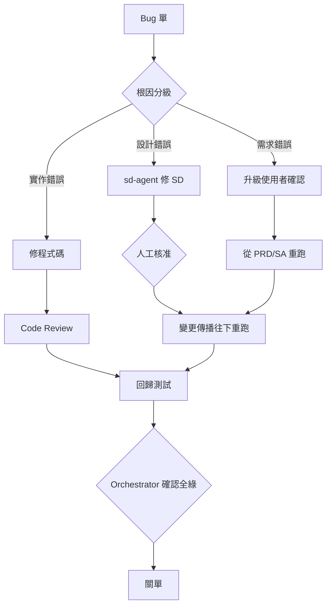

![[agents-04-cover.svg]]

# Bug 的向上傳播：根因分級，避免文件變謊言

> [!abstract] 這篇的重點
> 修 bug 最危險的不是修不好，而是**只改程式碼就收工**。每張 bug 單都要先問一句：錯在哪一層？錯在設計或需求，就要回到上游改文件，再往下重新傳播。

## 三個月後的新人

阿哲有一天很無奈地跟我說，新來的同事照著 PRD 實作了一個功能，上線後被客訴。

我們查了一下：這個行為，三個月前其實已經被當成 bug 修掉了。但當時修的人只改了程式碼，讓它「合理地」不同於 PRD 的寫法。PRD 和系統設計文件一個字都沒動。

程式碼是對的，文件變成了謊言。新人沒有做錯，他只是相信了文件。

## 問題漏在哪

> [!failure] 漏洞一：只 patch 程式
> 設計或需求本身有誤時，只改程式碼，等於把真相只留在程式裡，文件從此不可信。

> [!failure] 漏洞二：修的人自己關單
> 修復者說「好了」，就當作好了。沒有回歸測試把關，同一個 bug 會換個樣子再出現。

> [!failure] 漏洞三：單子裡沒有「當時的版本」
> 只寫「畫面壞了」，看不出當時的 PRD、SD 和程式碼是哪一版，bug-fixer 不知道該對照哪份設計。

## 解法：根因分級，往上傳

`bug-fixer-agent` 拿到 Jira 單，**先做根因分級**，再決定動哪裡：

| 根因 | 處置 |
|---|---|
| 實作錯誤 | 直接修程式碼，走 Code Review → 回歸測試 → 關單 |
| 設計錯誤（SD 層） | 回報 Orchestrator → 派 `sd-agent` 修 SD（人工核准）→ 變更傳播往下重跑 |
| 需求／分析錯誤（PRD/SA 層） | 回報 Orchestrator → 升級給使用者確認 → 從對應文件層重新往下傳播 |

這張表串起了前一篇的變更傳播。bug 往上走到被修正的那一層，之後就是同一套「標 STALE、依序更新」的機制，文件和程式碼才會一起回到一致。



### 兩條紀律

**紀律一：修完的單，不由 fixer 自己關。** 回歸測試綠了，由 Orchestrator 關單。修的人和驗的人必須分開。

**紀律二：bug 單要附「關聯產物版本」。** 格式固定：

```markdown
## Bug 單格式
- 重現步驟
- 預期 vs 實際
- 環境
- 嚴重度
- 關聯產物版本：PRD <hash>、SD <hash>、Code <commit>
```

有了這一行，bug-fixer 才知道要拿「當時」的設計來對照，而不是拿現在的。

### Jira 走 adapter

Bug 單的進出，我用同一套介面包起來：

```text
create_issue(summary, description, severity, labels, artifact_refs) -> issue_key
get_open_issues(filter) -> issue[]
add_comment(issue_key, body)
transition(issue_key, status)
```

階段 1 用本地模擬（每張單一個 JSON 檔，git 追蹤、離線可跑），流程跑通後再切換真實 Jira，只改 `STATE.json` 裡一個設定值。agent 不需要知道後面接的是哪一個。

給 bug-fixer 的核心指令大概是：

```markdown
先判斷根因屬於「實作」「設計」還是「需求」。
- 實作：直接修，送 Code Review。
- 設計或需求：不要動程式碼，回報 Orchestrator 並附上你的判斷依據。
修復後不要自己關單，等回歸測試結果。
```

## 改完之後

回到那個功能。這次 bug 單進來，bug-fixer 先查單上附的版本，發現問題出在 PRD 對該情境的描述本來就有疑義，判定為「需求／分析錯誤」。

它沒有動程式碼，回報給 Orchestrator，Orchestrator 把問題升級給我。我確認後修改 PRD，SA、SD、程式碼依序標 STALE、依序更新，手冊也跟著改了一章。回歸測試全綠，Orchestrator 才關單。

三個月後新人照著 PRD 做，做出來的就是對的。

## 速查表

| 根因 | 誰來修 | 修完之後 |
|---|---|---|
| 實作錯誤 | bug-fixer | Code Review → 回歸 → Orchestrator 關單 |
| 設計錯誤 | sd-agent（人工核准） | 變更傳播往下重跑 |
| 需求／分析錯誤 | 使用者確認後從 PRD/SA 重來 | 變更傳播往下重跑 |

> [!tip] 一句話記住
> ==每個 bug 先問「錯在哪一層」，只修程式碼，文件就會變成謊言。==

---

上一篇：[[agents-03-orchestrator|Orchestrator 不做事，只調度：STATE.json 與人工核准閘]]　｜　下一篇：[[agents-05-portability|可遷移性四規則：從 Claude Code subagents 到 Agent SDK]]

*故事情境為綜合改編。*
